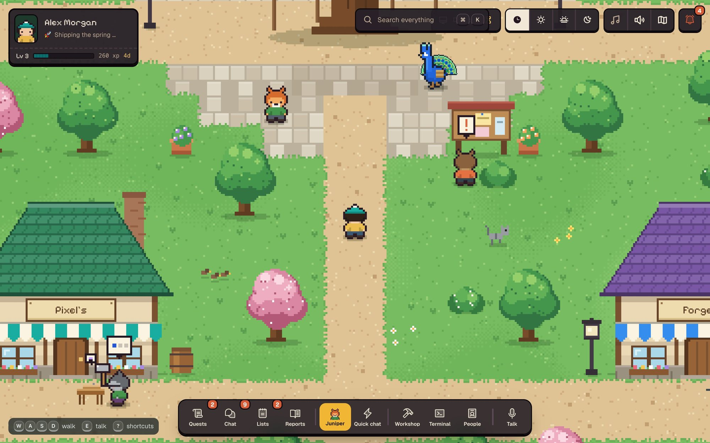
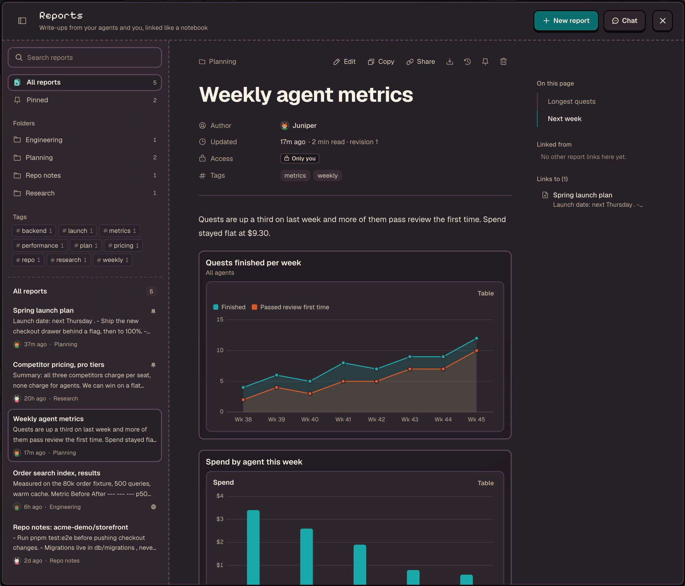
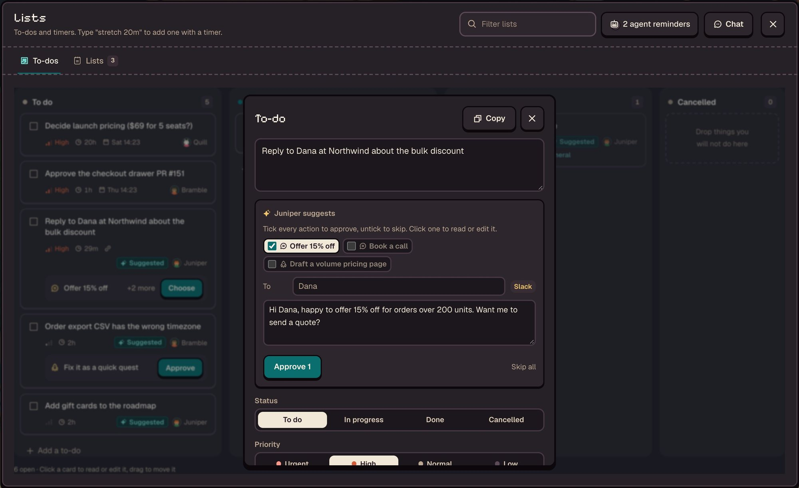
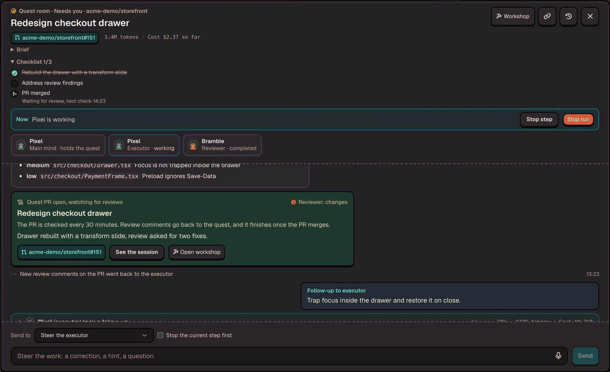
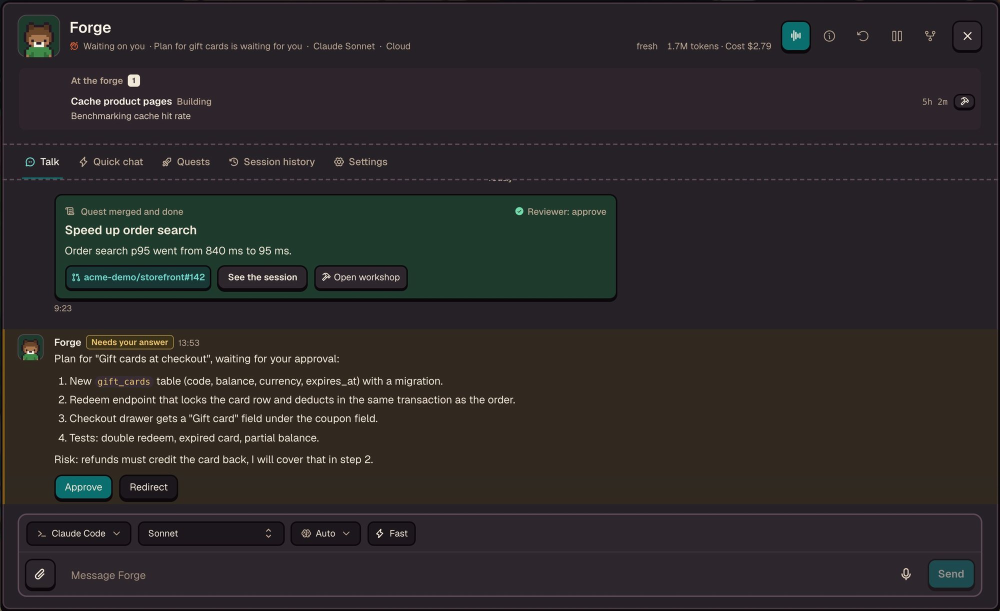
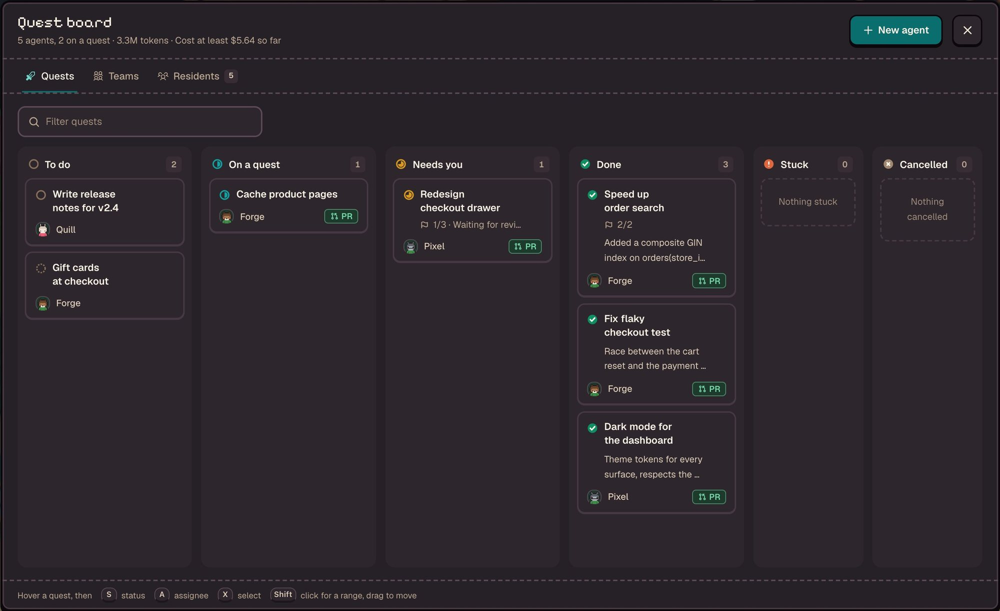
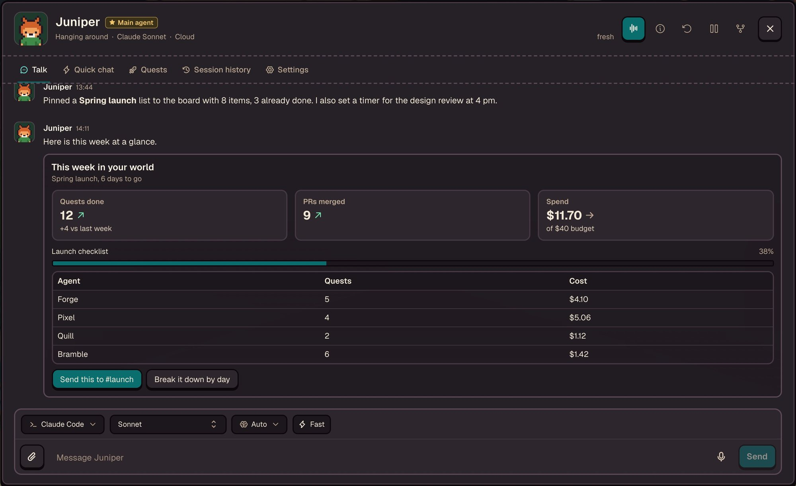
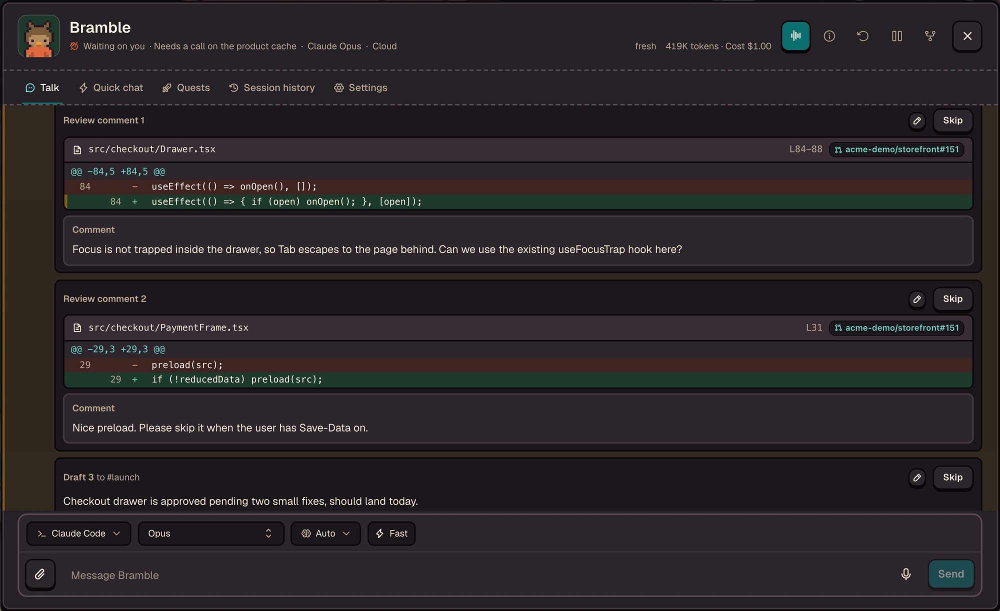
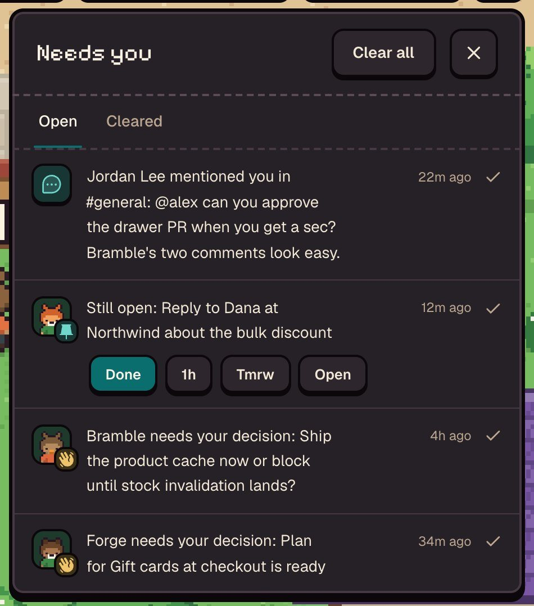
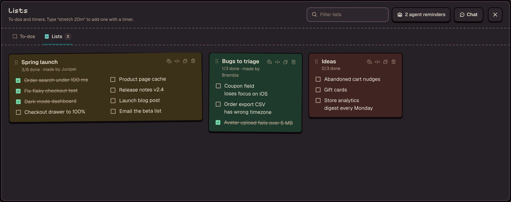

<p align="center">
  
</p>

<h1 align="center">Loka</h1>

<p align="center"><b>Stop chatting with agents. Start working with them.</b></p>

<p align="center">Loka is a workspace for you and your agents, not another chat window with bots in a sidebar. Quests end in pull requests, findings become reports you can talk to, and agents wake when a pull request, Slack thread, feed or schedule changes. Free and open source, running entirely on your Mac.</p>

<p align="center"><a href="https://loka.ygpt.dev/download"><b>Download for Mac</b></a></p>

<p align="center"></p>

Loka runs persistent coding agents on top of the CLIs you already use (Claude Code, Codex, Cursor, oh-my-pi, OpenCode). Each agent lives in a pixel town and keeps one long-running **main session** that remembers your conversations. When it takes on a quest it forks that session into a task session with full tools in its own git worktree, optionally gets an independent review, and the runtime commits, pushes, opens the pull request and reports back.

Loka is one person, one Mac, everything local. The app bundles its own Postgres, the Loka API, the web app and a runner that drives the agent CLIs on your machine. There is no sign-in, and nothing leaves your Mac except the calls your agent CLIs and `gh` make themselves.

## Requirements

- macOS 13 or later.
- At least one agent CLI installed and signed in: `claude` (Claude Code), `codex`, `cursor-agent`, `omp` or `opencode`. Loka uses the logins you already have.
- [`gh`](https://cli.github.com) signed in (`gh auth login`) if you want agents to push branches and open pull requests.

Open the DMG, drag Loka to Applications and open it. Onboarding creates your main agent and walks you through picking its CLI and model.

## More time for the work only you can do

- **Remembers.** Say it once. It keeps your project, your people and last week's decisions, and the work goes to whoever knows it best.
- **Reacts.** It watches the pull requests, threads, checks and inboxes you point it at, and starts when something changes.
- **Follows through.** Every quest runs to the end. Reviews, failing checks and the merge watch are set up by asking.
- **Brings decisions back.** Plans, drafts and next steps arrive as cards with buttons. One click and it carries on.
- **Safe.** Your keys stay yours. Grant one where it is needed, take it back any time.
- **Within budget.** Set a daily limit. Work pauses at the line and picks up tomorrow.
- **Fun.** Every agent has a face, a house and a walk home.

## Good on day one. Better every week after.

Everything your agents learn stays with you, on your Mac, whichever model you use next.

- **Memory you keep.** Each agent has one long conversation, its own notes and notes per repository, stored on your Mac and exportable as a file.
- **Any CLI, one team.** Claude Code, Codex, Cursor, omp and OpenCode agents work side by side, and an agent keeps its memory when you switch its CLI or model.
- **Wired to your work.** Every watch, feed, schedule and skill you set up by asking stays in place, so more work starts on its own each week.
- **Learns how you work.** Lessons from finished quests become notes and skills, and a permission you grant once becomes a rule for every later quest.

## Everything inside

- **Persistent agents.** Each agent has a persona, a CLI and model, powers, and a main session that keeps its memory. Switch models any time; switching CLIs hands the memory over.
- **Quests.** Agents work in their own git worktrees, report back with the checks they ran, and open pull requests. Optional per quest: an independent review with a fix loop, plan first (approve or redirect before any code is written), best of up to three attempts, CI feedback, pace and time limits.
- **Quest rooms.** Every quest shows its executor, report, review verdict, milestones, PR watch and live steering. Steer a running quest, stop it, or rewind a session.
- **Chat that does things.** Agents reply with clickable cards, ask questions with buttons, draft review comments you approve before they post, and file to-dos with suggested replies and quests.
- **Reports.** A linked notebook with folders, tags, backlinks, revisions and live cards.
- **Lists, timers, schedules and feeds.** Sticky-note lists, reminders, cron schedules, heartbeats, RSS feeds and inbound webhooks that wake agents.
- **Agent teams.** Group agents under a lead who splits quests into parts, or set up a starter team (two coders and a reviewer) in one step.
- **Kit.** Give agents MCP servers and skills. Keys you save are encrypted, granted per agent and never shown back.
- **Your Mac as the workshop.** A terminal, a file workbench, folder sessions in any folder you share, a browser for agents, and Slack capture whose tokens never leave the Mac.
- **Budgets and usage.** Daily dollar and token budgets per agent, cost per run, and a usage report agents can read to suggest cheaper models.
- **Connect other tools.** Talk to your agents from Claude Code, Cursor or any MCP client through Loka's MCP endpoint, with a token from Settings > Connect other tools.
- **GitHub and Slack, as they happen.** Your GitHub notifications reach the agents that watch them, using the gh login on your Mac, and agents can watch one pull request, Slack channel or thread instead of polling.
- **Threads, typing and read receipts** in agent chats and channels, and a microphone in every message box.
- **Linear and ClickUp webhooks** that turn issues into quests.
- **The world itself.** Districts to walk, an academy with challenges, background music and live voice.

## Loka in pictures

### Reports you can talk to

Organized write-ups with charts, tables and live cards. Open the chat beside a report to ask about it, and the agent updates the page.

<p align="center"></p>

### Follow-ups come drafted

Agents file to-dos with replies and next steps already written. Pick, tweak and approve.

<p align="center"></p>

### Watch the work in one place

Every quest has a room: each step, the review and the fixes. Send a follow-up mid-run or stop any step.

<p align="center"></p>

### Plan first for bigger changes

A plan-first quest waits for Approve or Redirect, then you follow it step by step.

<p align="center"></p>

### One board for every agent

Every quest from to do to merged, with who has it and what it cost.

<p align="center"></p>

### Chat with cards and charts

Talk to your agents like teammates. Replies carry charts, tables and buttons you act on in one click.

<p align="center"></p>

### Reviews you approve before they post

Agents review each other's work and draft GitHub comments pinned to the diff. Edit, skip or send them all.

<p align="center"></p>

### Only what needs you

Decisions, finished work and to-do nudges, with quick answers.

<p align="center"></p>

### Lists and timers

Sticky notes agents create, colour and tick off.

<p align="center"></p>

## Loka Pro

Loka Pro is coming soon. It adds organizations and team collaboration, the iPhone, iPad and Apple Watch apps, several Macs and cloud runners. Join the waitlist at [loka.ygpt.dev](https://loka.ygpt.dev/#pro).

## Supported CLIs

Each agent picks a CLI and a model, and can switch later. Models are discovered from each CLI at runtime, so new ones need no code change. [docs/backends.md](docs/backends.md) compares them on speed, cost and features.

| CLI | Sign in | Notes |
|---|---|---|
| `claude` (Claude Code) | `claude login` | Forks with `--fork-session`, runs inside Claude Code's Bash sandbox, warm processes for fast replies |
| `codex` | `codex login` | `codex exec` or `codex app-server`, steering and rewind |
| `cursor` | `cursor-agent login` | Forks by copying the chat store, warm turns over ACP |
| `omp` (oh-my-pi) | provider keys in `models.yml` | Per-agent model configs with secret references |
| `opencode` | `OPENROUTER_API_KEY` | Off unless `WORLD_ENABLE_OPENCODE=1` |

## Building from source

You need Rust (stable), Node 20 or later and the Xcode command line tools.

```bash
cd desktop && npm ci && npm run build
```

The prepare step (`desktop/src-tauri/scripts/prepare-sidecar.sh`) builds `loka-agent` and `loka-api` in release mode, builds the frontend as a standalone Next app, and downloads pinned, checksummed Postgres 17 and Node runtimes. The app and DMG land in `desktop/src-tauri/target/release/bundle/`.

## Development

[CONTRIBUTING.md](CONTRIBUTING.md) shows how to run the API, the web app and a runner straight from source against a local Postgres, and lists the tests and house rules.

## Architecture

```
web app (Next.js)  ──/api──▶  loka-api (Rust, Axum)  ──▶  Postgres
       ▲                          │      ▲
       └────────── SSE ───────────┘      │ /api/runner/{id}/poll
                                  loka-agent runner (this Mac)
                                          │
                        claude / codex / cursor / omp / opencode
```

- **`shared/`** (`loka-shared`) is all database access and domain logic.
- **`api/`** (`loka-api`) serves REST, server-sent events, the runner API, the external MCP endpoint and webhooks, and applies `migrations/` at startup.
- **`agent/`** (`loka-agent`) is the runner that leases jobs and drives the CLIs, plus the stdio MCP server agents use for World tools.
- **`frontend/`** is the pixel world, chat, quests, reports and settings.
- **`desktop/`** is the Tauri app that starts and supervises everything.
- Nothing polls: writers insert rows and Postgres triggers `pg_notify` the listeners.

More in [docs/architecture.md](docs/architecture.md); [CLAUDE.md](CLAUDE.md) maps every subsystem and its invariants. Security notes are in [SECURITY.md](SECURITY.md).

## License

Loka is licensed under the [GNU Affero General Public License v3.0 only](LICENSE) (`AGPL-3.0-only`). You can use, change and run it freely. If you run a modified version as a service other people use over a network, you must offer those users the source of your modified version under the same license.

Contributions are welcome. Contributors will need to agree to a Contributor License Agreement, which will be added to this repository; see [CONTRIBUTING.md](CONTRIBUTING.md).
